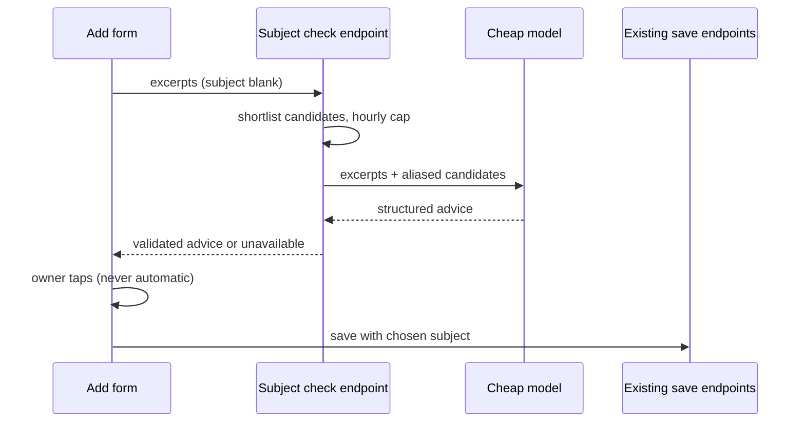

# Architecture: Add knowledge subject check

## What changes structurally
The Add knowledge form gains one read-only step before saving: when the Subject is blank it asks a new check endpoint for advice, shows the answer, and only then calls the unchanged save endpoints with the owner's choice. The check is a new, separate read path in the knowledge-source module with its own cheap-tier agent; the save path, the extraction pipeline and the subject-kind dispatch are untouched. Subject, chosen subject id and kind stay owned by the save path and the subject module.

## New infrastructure
- One agent registered with the existing agent registry; no new queue, table, worker, dependency or migration.

## Data model evolution
Not applicable. Advice is not stored; the only record is the existing LLM call log row.

## Failure modes
- Model error, bad output, timeout, budget or hourly cap: endpoint answers "unavailable"; the form saves unfiled with a visible notice.
- Model names a subject outside the offered set: that entry is dropped; nothing left means "none" and the form saves unfiled.
- Subject deleted or given children between check and save: the existing save endpoint refuses it and the existing refusal message shows.
- New-subject creation succeeds but the save fails: the subject remains and the form keeps the text with the existing per-block reason.
- Duplicate text under the chosen subject: the existing duplicate warning appears after the tap.

## Rollout
- Standard deploy; a server-side switch turns the check off, after which the form behaves as it does today.
