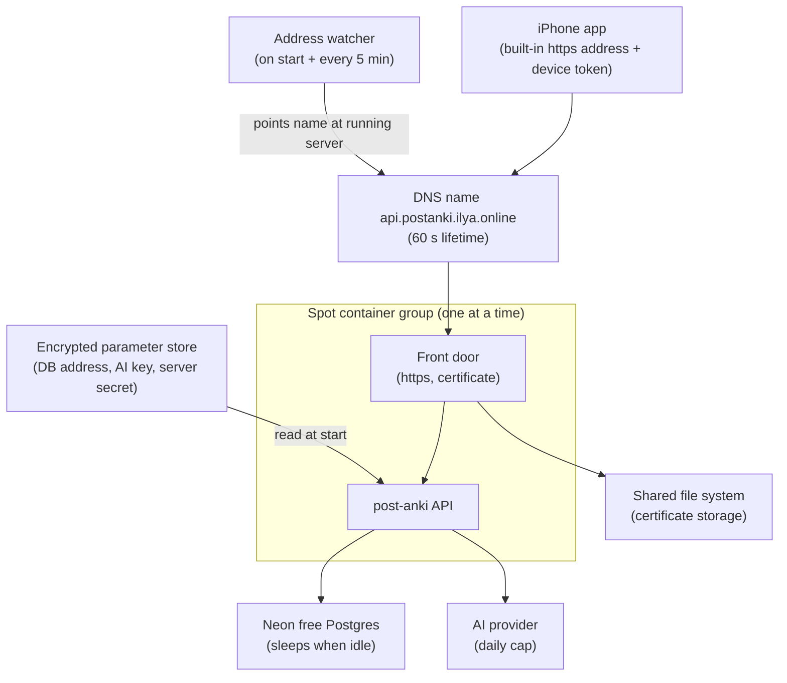

# Architecture: post-anki API on Fargate Spot

## What changes structurally

The prod API runs as one discounted, interruptible container group on AWS: the API itself plus a small front door that holds the https certificate, with no load balancer. Because the server's public address changes on every restart, a tiny watcher moves the API's DNS name to whichever server is currently running, on every start and again every five minutes. The certificate lives on a small shared file system so a replacement server reuses it. The database stays on the existing Neon free project, which sleeps when the API is idle; live sync, the web app, the bot and a dev environment are not deployed. The AWS infrastructure already in the repo is split so that its load balancer, other services and serverless API stay off unless explicitly turned on.

## New infrastructure

- Cluster capacity: discounted Spot capacity by default, regular capacity by one setting; arm-based servers; one container group of a quarter CPU and half a gigabyte.
- Container group: API (not reachable from outside) and front door (only ports 80 and 443 open to the internet).
- Shared file system holding only the front door's certificate data.
- Address watcher: a small function triggered by container start events and a five-minute schedule, allowed only to read server addresses and change the one API record.
- Image registry for API images, keeping the last few versions.
- Secrets as encrypted parameters created by the owner; infrastructure references them by name only.
- Log groups kept 7 days; a monthly AWS budget alert by email.

## Data model evolution

- No schema change from this work. The Neon database receives the nine pending schema changes through the existing migrate command, run by the owner after a backup.
- Later releases keep schema changes additive so the previous version still runs on the newer schema, which keeps rollback a version switch.

## Failure modes

- Spot interruption: the API is unreachable for roughly two to four minutes while a replacement starts and the name moves; in-flight background AI work on the old server is lost and has to be started again.
- No Spot capacity: the API stays down until capacity returns or the owner switches to regular capacity.
- Address watcher misses an event: the five-minute check corrects the name; until then the phone sees connection errors, never another party's server, because the certificate would not match.
- Database asleep: the first request after a quiet spell is slower by up to a few seconds.
- Missing or wrong secret: the container group fails to start and the deploy is rolled back; the smoke check reports it.

## Rollout

- Owner order: approve decisions, preflight, create secrets, read-only database status, labelled backup, migrate Neon, build and push image, first infrastructure run with the API record off, cutover of the API name, wait for the certificate, smoke check, mint the phone token, phone check.
- Rollback: earlier image version by one command; database restore from Neon's six-hour history or the labelled backup; DNS back to GCP by one documented command while GCP is alive; full teardown removes every cost.
