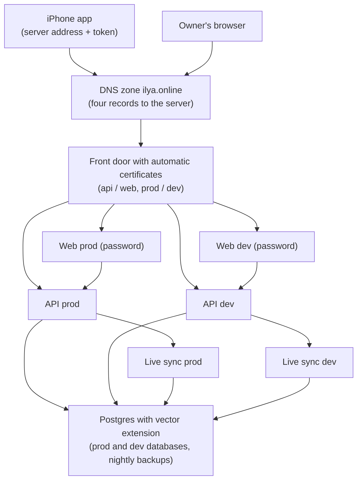

# Architecture: post-anki hosting for the iPhone app

## What changes structurally

All of post-anki that the phone and browser need moves onto one small rented server running containers: a front door that terminates https for four addresses, one Postgres server holding a separate prod and dev database, and per environment one API, one web app and one live-sync process. Only the front door is reachable from the internet. The server and its DNS records are defined as code; deploys ship ready-built images from the owner's Mac over SSH, so no image registry or CI runner is needed. The serverless and container-cluster AWS stacks already in the repo stay unchanged and undeployed.

## New infrastructure

- One rented server (2 vCPU, 4 GB RAM class) with a host firewall allowing only SSH (key only), http and https; created from a startup recipe that installs the container runtime, swap, automatic security updates and a nightly database backup job.
- DNS records in the existing zone: `api.postanki.ilya.online` (prod API, the iPhone app's built-in default), `postanki.ilya.online` (prod web), `api.dev.postanki.ilya.online` (dev API), `dev.postanki.ilya.online` (dev web). Dev records exist from the first deploy; prod records move only at cutover.
- Shared services: front door, Postgres. Per-environment services: API, web, live sync, each environment isolated by its own database, its own secrets file on the server and its own container group.
- Secrets live only in root-only files on the server, entered by the owner through a prompt; infrastructure state and images hold none.
- Owner-run scripts for preflight, secrets entry, image build and shipping, database status, backup and pull, one-time copy, migration, deploy, smoke check, token minting, promotion and rollback.

## Data model evolution

- No schema change. The local database (latest schema, the owner's real data) is copied once into the empty prod and dev databases on the server.
- The hosted database used by the old server is left untouched; it stays as the old server's data until that server is retired.
- After the copy, schema changes reach each environment only through the existing migrate command, dev first, then prod during promotion; consecutive releases keep migrations additive so the previous version still runs on the newer schema.

## Failure modes

- Single server, single disk: a server loss means restoring from the newest backup the owner pulled to the Mac; the runbook makes pulling backups a weekly step.
- Memory pressure from two full environments on 4 GB: per-container memory limits and swap keep prod alive; dev's containers are stopped first if needed.
- Certificate issuance at prod cutover needs the prod records to point at the server first, so prod https is unavailable for about a minute; the old server still answers until DNS caches expire.
- If an environment's shared secret is missing, the API lets every request through; the smoke check fails loudly on that.
- Web is reachable only behind the front door's password, because the web app has no login of its own and calls the API with the shared secret.

## Rollout

- Owner order: rent server via infrastructure code, preflight, secrets per environment, build and ship images, copy local data into both databases, deploy dev, mint dev token, smoke dev, phone check on dev, deploy prod, prod DNS cutover, smoke prod, mint prod token, phone check on prod.
- Old server stays running until prod has been healthy for an agreed period; pointing the prod records back at it is the DNS rollback.
- The old server's push-triggered deploy pipeline is left untouched; retiring it stays with the existing shutdown item.
