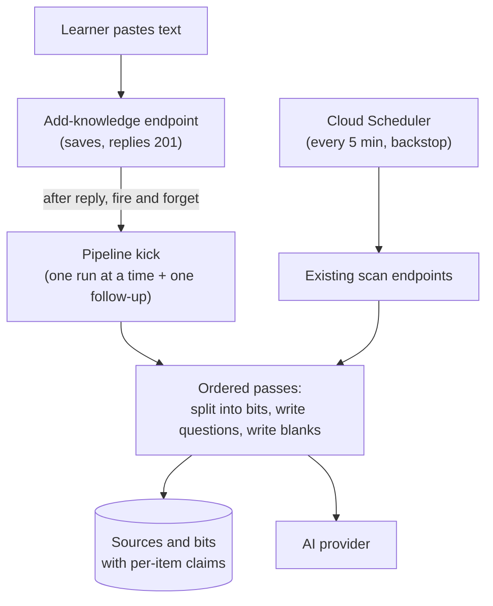

# Architecture: Run bit detection and question generation right after paste

## What changes structurally
The add-knowledge endpoint gains a background trigger. After a successful save and after the response is sent, it asks a new pipeline-kick component inside the knowledge-bit entity to run an ordered list of existing scan passes: split into bits, write questions, write fill-in-the-blank cards. The kick lives in the API process and holds only in-memory state: one in-flight run plus at most one queued follow-up. It owns no data. Every pass keeps its own database claims, so it runs safely next to the timer jobs, which stay unchanged as the backstop.

## New infrastructure
None. No new route, worker, queue, scheduler job or Cloud Run setting.

## Data model evolution
Not applicable. The passes use the existing per-item claim columns and source status.

## Failure modes
- CPU throttling after the response (request-based billing, scale 0 to 1): a run can stall until the next request gives the instance CPU again, for example the 5-minute timer call. If the instance is shut down, its held items return after the existing hold timeouts (15 minutes for sources, 10 minutes for bits), and the timer job processes them.
- An AI call that fails during a stalled run follows today's failure rules. A failed split is final for that paste, and a failed question write uses one of 3 attempts. This is the same exposure the scheduler path has, now more likely during a stall.
- A pass that throws is caught and logged, and the next pass still runs. The busy guard always resets.
- Duplicate work is prevented by the per-item claims, not by the in-memory guard. The guard only limits runs inside one process, and production runs at most one instance.
- A shutdown during a run can stop a pass midway. Writes are either per-item transactions or claim-checked, so no partial set of bits is left.

## Rollout
- Standard deploy. Revert removes the trigger. The timer jobs keep the pipeline working with or without it.
- Item 8 adds the basic-card pass by appending one entry to the ordered pass list.
