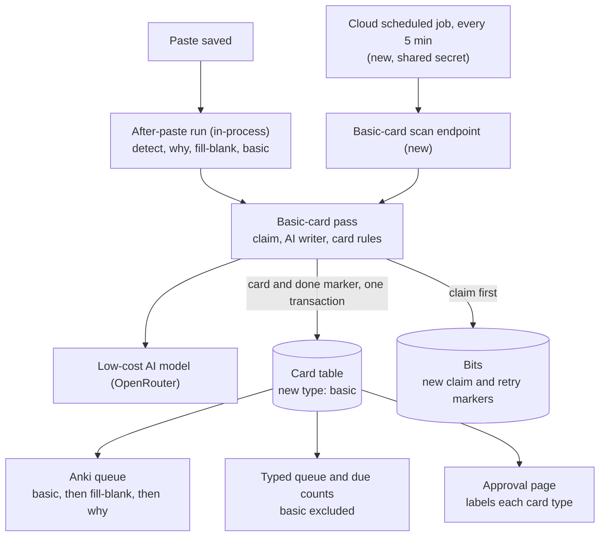

# Architecture: F-basic — basic front/back card variant

## What changes structurally

A third card-generation pass joins the why-question and fill-in-the-blank passes inside the knowledge-bit entity. It has its own low-cost AI writer, its own instructions and its own per-bit claim and retry markers, and it writes into the same card table under a new card type. Three places run it: the after-paste run (after the other two passes), a new scan endpoint, and a new 5-minute scheduled backstop job. The read side changes in three places. The Anki queue ranks the new type first when it picks one card per bit. The typed mode and its topic due counts ignore the new type, and typed grading refuses it. The approval page labels every card by type.

## New infrastructure

- One Cloud Scheduler job that posts to the new scan endpoint every 5 minutes. The schedule is a config key and the time zone matches the other knowledge-bit jobs. The bearer shared secret is the same one the existing jobs use, and the job is declared in the infrastructure code only.
- No new service, worker, queue or secret. The pass runs inside the existing API service.

## Data model evolution

- Bits gain five markers for the new pass: generated-at, failed-at, attempt count (default 0), claimed-at and claim token. They mirror the two existing passes. The change is additive and nullable, so no backfill is needed. Existing bits start as "not yet generated", which is how the rollout fill-in happens.
- The card type is stored as free text and checked in application code, so adding the "basic" value needs no database change. The existing rule of one active card per bit, type and slot already limits each bit to one basic card.
- Editing a pending bit's text also clears the new markers, the same way it clears the other passes' markers.

## Failure modes

- AI provider down or bad output: no card is stored and the attempt counts. After three attempts the bit stops being picked up. Its other card types are unaffected.
- A claim goes stale (more than 10 minutes, for example a slow run or an instance that was stopped): another run can take the bit over. The original run's write then fails its ownership check and rolls back, so the worst case is one duplicate paid call, never a duplicate card.
- The after-paste run stalls because the API's CPU is throttled after the response is sent: the 5-minute job catches up.
- Rollout fill-in: every existing non-rejected bit becomes a candidate at once. Cost is spread out at 50 per run, and serving switches to the new cards gradually as they arrive.
- The new job fires before the API that serves its endpoint is deployed: the call gets a 404 and the next run retries. The job is declared to depend on the API service.

## Rollout

- Standard deploy. CI applies the generated migration before the API deploys. Infrastructure applies via the existing pipeline, never by hand.
- Rollback: revert the code and remove the job from the infrastructure code. Basic cards already stored stay in the table, and the reverted read paths do not know the type. Hiding them needs a one-off generated data migration, never a manual edit.
