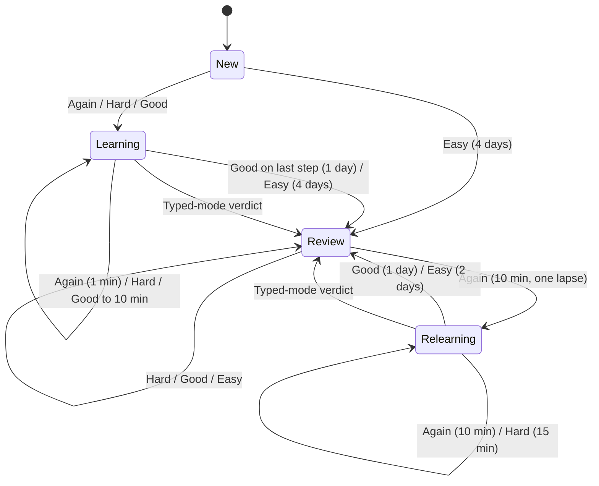

# Architecture: F-learn — minute-level learning steps

## What changes structurally

The per-bit schedule stops being a single "next due date" and becomes a small state machine: new, learning, review and relearning, plus the current step and a lapse count. The four-grade rule owns every transition between those states and stays a pure computation; the self-grade step, the queue and the interval previews all read the same stored state and feed it to that rule. The typed mode keeps its own three-verdict formula and only resets the state to review. The everyday (unscoped) queue gains a front tier for learning cards and a back tier that serves soon-due learning cards early; scoped queues are untouched.

## New infrastructure

None. No new process, job or cloud resource.

## Data model evolution

- The bit-schedule table gains three state fields: phase, current learning step and lapse count.
- Every existing schedule row takes the defaults: in review, first step, zero lapses. That matches how those cards were scheduled before, so no backfill runs and no historic review is reinterpreted.
- "New" is never stored: a bit with no schedule is new, as today.
- The prior-schedule copy kept with each self-grade gains the same three fields. Older copies without them stay valid; any reader defaults the missing fields to in review, first step, zero lapses.
- Additive only, with constant defaults, so the change does not rewrite or hold the table.

## Failure modes

- Deploy window: the database is upgraded before the new API starts. The old API never reads the new fields, and its writes take the defaults, which describe its own behaviour exactly.
- A learner who leaves mid-step finds the card overdue next time; it is served first, as Anki does.
- Within one fetched batch, a card just failed does not reappear; it returns on the next fetch, and the early-serve tier keeps the session from ending while it is minutes away.
- A stored step outside the configured steps (for example after the steps are shortened) is treated as the last step, never an error.
- Another planned feature (suspend and bury) also changes this table; the two upgrades must be generated one after the other, never in parallel.

## Rollout

- Standard deploy: CI applies the upgrade before the API deploys, and the web app deploys after the API.
- Rollback is a code revert; the three fields stay and are ignored by older code.
