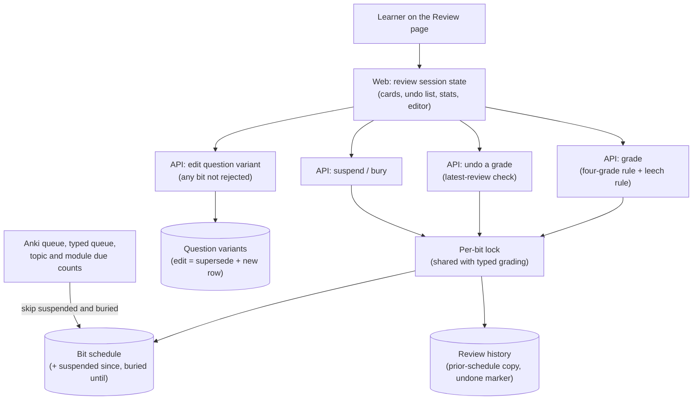

# Architecture: F-session — in-session controls

## What changes structurally

The per-bit schedule gains two control fields: "suspended since" and "buried until". Every review surface reads them through one shared eligibility rule: both review queues and the topic and module due counts. Two new write paths join the existing grade path, and all three take the same per-bit lock. Undo restores the prior schedule copy that every grade already keeps. Suspend and bury toggle the control fields. The grade path itself now decides leech auto-suspension with a pure rule. On the web, a single session state machine on the Review page owns the cards, the undo list, the edit swap and the session statistics. Nothing about a session is stored on the server beyond the review history, which already exists.

## New infrastructure

None. There is no new process, worker, scheduler job or cloud resource. Both new endpoints run in the existing API service, behind its existing token check.

## Data model evolution

- The bit schedule gains two nullable timestamps, "suspended since" and "buried until". There is no backfill: existing rows read as not suspended and not buried.
- Suspending or burying a never-reviewed card creates its schedule row in an ungraded state. Every reader treats an ungraded row exactly like a missing row: the card stays new, both for the queue and for the new-card daily limit.
- The prior-schedule copy kept with each grade gains the two control fields. Undo restores the grade's own fields from the copy. It keeps any suspension or bury the learner set after that grade, except a suspension the grade itself caused as a leech.
- A grade counts as latest only while it is not undone, no later live grade of that bit exists, and the schedule still records that grade as its most recent review. Typed answers keep no history entries, so this last check is what detects them.
- "Leech" is never stored. It is derived from the failure count, with auto-suspension at 8 failures and every 4 after that.

## Failure modes

- Undo after the card was reviewed again elsewhere is refused with a "not latest" answer, and nothing is written. The client drops only that one undo entry.
- A lost undo response followed by a retry gets "not latest" the second time, because the first undo already marked the grade undone. The schedule is never restored twice.
- One stray key press suspends a card, and there is no unsuspend control. Undo is the on-screen recovery. The API's unsuspend is the only path after the session ends.
- An edit of an approved bit's question creates a new variant. A client still holding the old one can grade it (superseded variants of approved bits stay gradable), so a stale tab does not break. The new variant's embedding is filled in by the existing embedding scan.
- A session lives only in the browser tab. A reload loses the undo list and the statistics, while every grade, suspend, bury and edit is already saved on the server.

## Rollout

- Standard deploy. CI applies the generated migration before the API deploys, and the web app deploys after the API.
- The new columns are nullable and read as "not suspended, not buried", so the old API keeps working against the migrated database.
- Rollback: revert the code. Any cards suspended in the meantime stay out of rotation only while the new code runs. The old code ignores the columns, so a revert puts them back in rotation. Dropping the columns needs its own generated migration.
