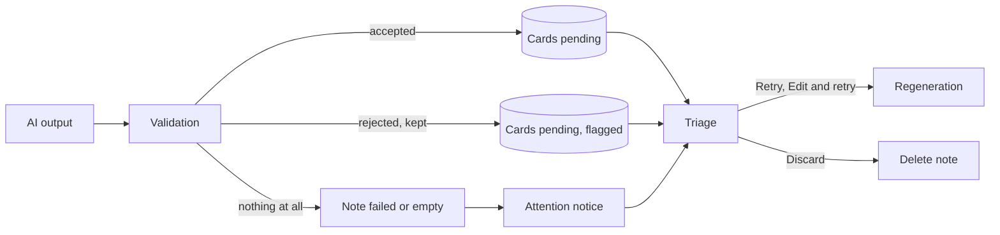

# Architecture: Extraction failure visibility

## What changes structurally
Extraction stops treating rejected cards as garbage: the validation boundary hands back both accepted and rejected cards, and storage keeps rejected ones flagged. A new read-side concept, "attention", is derived from note state (failed, finished empty, stuck) and served by the existing triage and count reads. Wording lives in the shared package so every client maps codes identically.

## New infrastructure
None.

## Data model evolution
- One additive nullable column on the cards table holding the review-flag reason code. No backfill; null means a normal card.
- No change to notes table; attention is derived from status, failure reason, update time, and live card count.

## Contracts
- Count read: adds attention count to the existing response (additive).
- Triage read: opt-in parameter returns extra entries with no cards and an attention object (kind, reason code, first words, time); cards gain an optional review-flag reason. Reason text is built on the client from the shared map.
- Regeneration start: optional replacement text.

## Ownership
- API owns deriving attention state and the stale takeover rule (20 minutes, aligned with the existing stale reset).
- Shared owns the code-to-wording map and attention kinds.
- Web owns presentation and actions.

## Failure modes
- Retry races a still-running run: claim is atomic, a loser gets already running and the notice keeps its state.
- Takeover of a note whose old run later finishes: the existing claim-ownership check discards the stale run's writes.
- Unknown future failure code: generic wording.
- Edit text exceeding limit: refused before any change.
- Flagged cards flood: capped at 3 per chunk.

## Rollout
Migration first, then API, then web. iOS follow-up: if the iOS pending screen should surface failed notes, it needs to request attention entries and render the shared wording; until then it keeps working unchanged.
