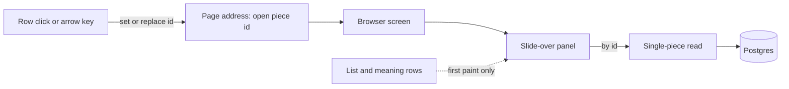

# Architecture: Knowledge browser detail slide-over

## What changes structurally

The browser gains one new read, a single approved piece by id, and one new screen part, a slide-over that renders from that read. The page address owns which piece is open (one extra field next to the filters); the list stays the owner of rows and selection and never feeds the panel's content except for the first paint. The panel owns its own data, so list refetches, filters and meaning search cannot reach it. Everything is read-only and free: no paid calls, no writes.

Ownership and data contract:
- The single-piece read returns one piece: text, context/example, source (type, label, link, added date), subject path, tags, review state, and every active phrasing with its own answer, card type and fill-in-the-blank sentence. Visible only for approved pieces, same as the list; otherwise "not found".
- Subject path is computed from the subject tree on the server; the web shows it as given.
- Selection (checkboxes, shift, cmd/ctrl) stays in the existing selection owner and is untouched; the click rule decides whether a click means open or select.
- Keyboard: the panel's Escape listener runs before the selection owner's, so Escape closes the panel first.

## New infrastructure

None.

## Data model evolution

Not applicable. All data already exists; no migration, no new index (lookups are by primary key and by piece id on tables already filtered that way).

## Failure modes

- Unknown, deleted or unapproved id: read answers not found; panel shows "no longer exists" with Close.
- Read fails: panel keeps the row text, shows Retry.
- Open id in the address names a piece outside loaded pages or filters: panel still works, since it never depends on the list.
- Route ordering: the by-id route must not capture literal paths such as overview, browser or export; guarded by a router test.
- Many fast arrow presses: each step replaces the address entry and reads one piece; reads are cached by id, so repeats are free.

## Rollout

Standard deploy. API ships with or before the web build; the web build is held until the `meaning-search-ui` work in the same browser files is finished.
