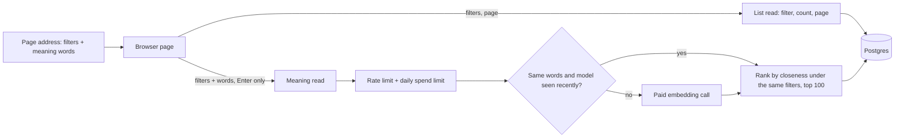

# Architecture: Rich filters, column controls and search by meaning in the knowledge browser

## What changes structurally

The browser's list request gains one shared filter contract that the web page, its address bar and the API all read, and the API applies every filter in the database so filters compose with paging. A second, separate read path ranks pieces by meaning: it is the only browser request that can cost money, it embeds the typed words once (reusing a recent result for the same words and model), then ranks inside the database under the same filters and returns one capped, unpaged list. The cheap list path never reaches the paid embedding service. On the page, filters and meaning words are owned by the address (shareable), column order and visibility by the browser's local storage (personal), and one toolbar owns every control plus the selection actions.

## New infrastructure

- None. Uses the existing pgvector extension, the existing closeness index on knowledge pieces, the existing embedding client and spending limit. No new dependency, service or queue.

## Data model evolution

- No schema change and no migration. Every filter reads columns that exist today.
- Contract change only: the list response gains a total match count and, per row, the real piece count of its source; a new meaning-search response carries a closeness score per row, a count of filtered pieces without meaning data, and whether the 100-row cap was hit.

## Failure modes

- Daily spending limit reached: meaning search answers with the existing "budget exceeded" refusal; the list and word filter keep working.
- Embedding service down or slow: meaning search fails after the existing retry and timeout; the page shows a retry and keeps the previous list.
- Bursts of searches: a per-server limit refuses beyond a small number per minute before any paid call.
- Embedding model setting changed without re-embedding stored pieces: rankings become meaningless while still returning rows. Stored pieces do not record their model, so this stays an operating rule, not a runtime check.
- Filtered closeness search on a large collection can return fewer than the closest matches when the index scans too few candidates; the search widens its candidate pool whenever a filter is set, which is ample at today's size.

## Rollout

- Local and CI: standard deploy, nothing to run; the local database already has pgvector and every migration.
- Production database (owner step, read-only to us): enable the pgvector extension and apply the pending migrations, which include enabling the extension, the closeness columns and their indexes, before shipping this API version; then the owner decides whether to pay for back-filling meaning data for existing pieces. Until back-fill, meaning search reports pieces as not ready rather than failing.
- Rollback: revert the release; nothing persistent changes.
