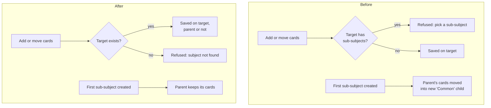

# Architecture: Let parent subjects hold cards

## What changes structurally

Any subject can own cards, whether or not it has sub-subjects. The server stops enforcing "cards only on subjects without children" in its three write paths (adding knowledge, moving cards, AI placement) and stops relocating a parent's cards into a "Common" sub-subject when the parent gains its first child. The read side already treats a subject as "itself plus all descendants", so review, counts and the browser need no structural change. The public answer contract narrows: the "subject has sub-subjects" refusal is no longer produced, and clients that still understand it are unaffected.

## New infrastructure

None.

## Data model evolution

- No schema change and no data migration. Existing "Common" sub-subjects stay as ordinary sub-subjects.
- The already-applied backfill migration that created "Common" children stays in the migration history unchanged.

## Failure modes

- A child created or moved under a parent while that parent is being merged or deleted must still wait for the merge or delete; the per-parent lock stays even though nothing is moved any more.
- A rolled-back server would refuse new adds to parents again, but cards already on parents stay valid and visible, because parents that already have children are never re-absorbed.
- Deleting a parent that holds its own cards leaves those cards pointing at a removed subject, the same as deleting any subject today.
- The placement prompt grows by the parent subjects' course topics, still bounded by the existing topic cap.

## Rollout

- Standard deploy of the server and the web app; no ordering needed between them.
- No phone or Mac release is needed; installed builds keep working.
