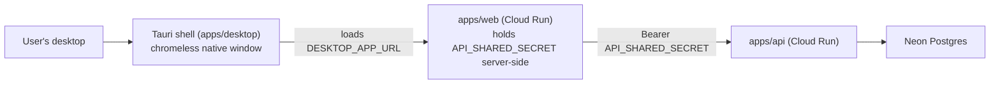

# Architecture: Tauri desktop app for Post Anki

## What changes structurally

A new deployable artifact, `apps/desktop`, joins the monorepo: a Tauri (Rust + OS WebView) shell
that displays the already-deployed `apps/web` site in a chromeless native window. No new backend,
no new API surface, no new database table, no new authentication mechanism, no new cloud
infrastructure. `apps/web` and `apps/api` are untouched by this pass.

This deliberately rejects the plausible-but-riskier alternative — a native app with its own
frontend calling `apps/api` directly, gated by a new per-user login/session-token system. That
alternative is a legitimate future shape (see Security decision below) but is not required to
satisfy this wishlist item: "wrapping the same web app... reusing the same apps/api backend...
without a separate backend" is fully satisfied by the webview shell alone, since `apps/web`
already reuses `apps/api` for every request. Building a new frontend and a new auth surface here
would add a security-relevant change (a new middleware path guarding every existing `apps/api`
route) whose only justification is speculative future need, not anything this item asks for.

## Security decision (explicit, per this task's brief)

- **Rejected:** copying `apps/web`'s server-side `API_SHARED_SECRET` scheme into the desktop
  bundle. A Tauri binary ships to the end user's own machine — anything embedded in it (a
  compiled-in secret, a build-time env baked into the binary) is extractable by that same user or
  anyone who obtains the binary. This shape never does that: it holds zero `apps/api` credential
  anywhere in `apps/desktop`.
- **Chosen:** the desktop shell carries no credential of its own. It loads `apps/web`'s deployed
  origin, whose Node server remains the sole holder of `API_SHARED_SECRET`, exactly as today for
  a browser tab. The desktop app is architecturally indistinguishable from a browser visiting the
  same URL — no new trust boundary, no new secret-exposure surface.
- **Remote content gets no native bridge.** Tauri v2 does not expose its native `window.__TAURI__`
  APIs to remotely-loaded content unless a capability explicitly grants that origin access. This
  shell adds no such capability, so `apps/web`'s pages run inside the shell exactly as privileged
  (i.e. unprivileged) as they'd run in a regular browser tab — the native shell cannot be
  leveraged by the remote page as an escalation path.
- **Deferred, not built here:** if a future slice wants the desktop app to talk to `apps/api`
  directly — most plausibly to build genuine offline support on top of the already-reusable
  Electric shape gatekeeper at `docs/architecture/local-first-electric-sync.md` — that slice must
  add real per-user authentication: a login screen exchanging credentials for a short-lived
  session token issued by `apps/api` (e.g. an owner-credential check plus a revocable session
  table, dual-accepted alongside the existing shared-secret path so `apps/web` is undisturbed),
  with the token held client-side only in an OS-keychain-backed store (e.g.
  `@tauri-apps/plugin-stronghold`) — never a static shared secret, never plain-text storage. That
  is its own spec when it's actually needed, not scope started or partially built here.

## New infrastructure

None. No new Cloud Run service, no Pulumi changes, no new database table. `apps/desktop` is a
local build artifact — a Tauri project developers build and package on their own machine. This
pass does not stand up CI/release/code-signing pipelines for it (see `todo.md` — deferred, and
unverifiable on this machine since no Rust toolchain is installed here).

## Data model evolution

None.

## Failure modes

- **Remote origin unreachable** (no internet, or `apps/web`'s Cloud Run instance cold-starting or
  down): the webview's navigation-failure event must be caught and rendered as a retry state
  rather than left as a blank window (SCENARIO 2).
- **Wrong URL baked into a build** (e.g. a release build accidentally pointing at localhost, or a
  dev build pointing at production): mitigated by one explicit env-controlled config value
  (`DESKTOP_APP_URL`) read at Tauri build time, with the release default set to the production
  origin and a documented override for local development against `vite dev`.

## Rollout

Nothing is deployed to any shared environment — this produces a local, developer-built desktop
binary (macOS first, since that's the only OS available on this machine; Windows/Linux targets
are configuration-only until built and tested on those OSes). No production infrastructure
changes, so there is no rollout/rollback story beyond deleting the local build output.

## Flow

