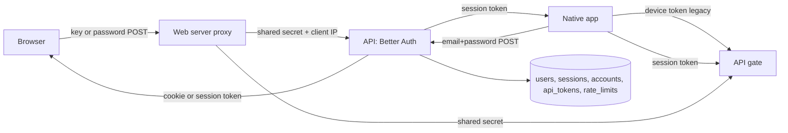

# Architecture: owner sign-in methods and credential order

## What changes structurally
Better Auth stays the single session authority. Three sign-in methods (device key, email and password, optional magic link) all end by creating one Better Auth session for the one owner user. The API gate gains a third accepted credential, a Better Auth session token, alongside the shared secret and device tokens; a few Better Auth paths used by native clients lose the shared-secret-only rule.

Credential order at the gate: shared secret, device token, Better Auth session token, otherwise unauthorized. The web page gate keeps using the session check through the proxy.

## New infrastructure
- None. One new non-secret deploy variable (owner email); existing auth secret becomes mandatory in production.

## Data model evolution
Not applicable. Existing users, accounts (password hash), sessions, api_tokens and rate_limits tables are reused; build confirms no migration.

## Failure modes
- Missing auth secret or owner email: web reports unavailable (503), same as today's guard.
- Database unavailable during sign-in: generic failure, no session.
- Leaked device key: revoke script ends token and sessions.
- Brute force on password: rate limited, generic message.
- Rate-limit client IP missing (proxy header absent): all callers share one bucket, failing safe toward locking out.

## Rollout
- Deploy API then web via the existing workflow (owner-run). Old apps unaffected. Owner then mints a web key and optionally sets a password. Credential retirement for old paths is a later owner decision.
