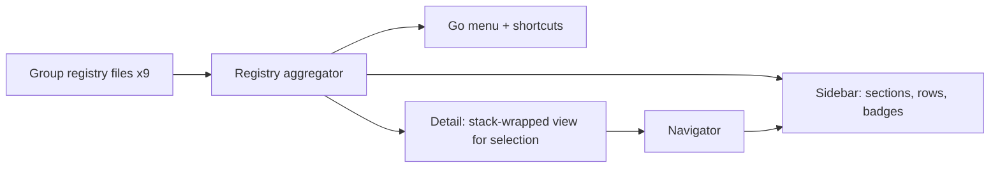

# macOS app, round 3: full iOS parity, runnable locally from Xcode

state: confirmed (planned without questions; defaults logged below)
Complexity: Very Complex (about 104 iOS files across 9 feature groups; no server or data-model change)

## Summary

Every iOS feature becomes usable on the Mac: study modes, library and capture, learning tools, course authoring, subject and domain management, language practice, duplicates and admin. The Mac sidebar becomes grouped sections (Study, Library, Learn, Manage, Admin) fed by one small registry file per feature group, so feature agents add files instead of editing the root view. The last wave makes the app easy to develop on a Mac: a dev server address from `Local.xcconfig`, a launch-time connection and sign-in check, a smoke-test target, a run script and README steps. Business rules and the server are untouched; the iOS app must behave exactly as before.

Architecture stays as plan.md/plan-2.md set it: `Packages/PostAnkiAPI` is the data contract, `Sources/Shared` holds views and models both apps compile, `Sources/PostAnkiMac` is the Mac shell. What changes: almost all iOS feature code moves into `Sources/Shared` in one mechanical wave, and Mac navigation moves from a hard-coded enum switch to a declarative registry.

## Current state (Facts, read from code)

- Sidebar: `enum MacSidebarItem` with 6 cases (home, courses, review, knowledge, progress, ingest) in `Sources/PostAnkiMac/MacSidebarItem.swift`; `MacRootView.swift` switches over it; `MacCommands.swift` builds the Go menu (Cmd-1..6) and Cmd-N from the same enum; selection persists in `@AppStorage("mac.sidebarSelection")`.
- `Sources/PostAnkiIOS` has 117 Swift files (11,347 lines); `Sources/Shared` has 34. No iOS file imports UIKit, VisionKit, Speech or PhotosUI (grep); the iOS-only API in use is `navigationBarTitleDisplayMode`, `topBarLeading/Trailing`, `keyboardType`, `textInputAutocapitalization`, `EditMode` (only `CourseEditModel/Screen`, `KnowledgeListScreen`). `fullScreenCover` is unused.
- iOS entry points: tab bar (Home, Courses, Review, Progress, Ingest = `IngestScreen` answer queue, Inbox = `KnowledgeItemInboxScreen`); Home sections link to daily push, search, source library, content inbox, Notion import, learning list/paths, decide, language practice, tags, ask, notes search, open questions, study sessions, resurfacing gaps; `SettingsToolsSection` (iOS-only, guarded in Shared `SettingsScreen.swift:97`) links knowledge maps, refocus, duplicates, admin.
- Hubs referenced across groups: `TopicStudyScreen` (from courses, search, tags, daily push), `CurriculumDetailScreen` (inside iOS `CoursesScreen.swift:36`; from course builds, search, learning list, refocus, domain recommendations), `ExerciseScreen`, `ChatViews` + `StudyChatModel` (ask, socratic, topic chat, knowledge-item chat), `DomainMapError` (domain screens and refocus).
- `ExerciseScreen` queues offline answers in iOS `PendingAnswerQueue`, flushed by `HomeView` on activation; the Mac app only flushes `PendingGradeQueue`.
- API base URL: `APIClient.baseURLString` in `Packages/PostAnkiAPI/Sources/PostAnkiAPI/APIClient.swift:12` reads UserDefaults `apiBaseURL`, default production; the shared Settings screen edits it. Requests use `URLSession.shared`; tokens are sent only over https or to localhost/127.0.0.1.
- `Config/Base.xcconfig` includes `../Local.xcconfig` (repo root, gitignored). `manual-test-sequence.md` wrongly says `Config/Local.xcconfig`. Package tests: Swift Testing, 34 passing, fixtures under `Packages/PostAnkiAPI/Tests/PostAnkiAPITests/Fixtures`.

## Decisions taken (defaults, logged; no questions asked)

1. One mechanical port wave (W1) moves every iOS feature file to Shared at once instead of per-group moves. Reason: hubs are referenced across groups, so per-group moves would make parallel Mac builds fail on each other's half-moved files.
2. iOS shell files stay iOS-only: `PostAnkiIOSApp`, `HomeView`, `HomeScreen`, `Home*Section` (4), `SettingsToolsSection`, `DueReviewScreen`, `DueTodayCard`, `KnowledgeListScreen`, `ProgressScreen`, `CoursesScreen` (list only; `CurriculumDetailScreen` and its private `TopicRow` split out to Shared).
3. iOS-only modifiers go through one shim file, not scattered `#if`s: inline title, leading/trailing toolbar placement (`.primaryAction`/`.navigation` on Mac), URL/plain text input, Mac sheet minimum frame. `EditMode` stays behind `#if os(iOS)` in the two course-edit files.
4. Sidebar sections and entries (ids keep existing raw values so stored selections survive): Study: Home, Review, Quick practice, Study sessions, Gaps coming back, Daily push, Language practice, Progress. Library: Courses, Knowledge, Inbox, Sources, Content inbox, Tags, Search, Notes, Add knowledge, Notion import. Learn: Learning list, Learning paths, Challenge my thinking, Ask your cards, Open questions. Manage: Subjects, Knowledge maps, Course builds, Refocus suggestions, Duplicates. Admin: Admin scans. Sections are collapsible; collapse state persists in AppStorage.
5. Shortcuts: Cmd-1..6 unchanged (Home, Courses, Review, Knowledge, Progress, Add knowledge); Cmd-Shift-F Search; Cmd-Shift-L Learning list. Everything else is reachable from the Go menu (grouped by section) without a shortcut. Reserved elsewhere: Cmd-N, Cmd-R, Cmd-comma, Cmd-Shift-M, Cmd-Option-S, digits 1-4 in review/quiz views.
6. Each detail is wrapped by the root in a `NavigationStack` reset when the sidebar entry changes, so shared screens' links work unchanged; an entry whose Mac view already owns a stack opts out.
7. Cross-entry jumps (Home "Study now" to Review, Cmd-N to Add knowledge) go through a small navigator object in the environment that writes the stored selection. Deep links into a topic from another entry push inside the current stack (iOS parity), never switch entries.
8. Mac idioms: `Table` with selection for list-shaped admin data (sources, content inbox, tags, subjects, study sessions, phrase bank, admin scans, decide history); context menus mirroring each row's existing actions; `onDeleteCommand` where a delete call exists; Return submits single-line answers, Cmd-Return submits multi-line editors; chat composers send on Return. Drag and drop only where an existing call takes the input: text dropped on Learning list opens capture prefilled; topics reorder by drag in course edit if the edit model already supports moves. Multiple windows: no.
9. Feature agents never edit `Packages/PostAnkiAPI`; an API gap is reported, not patched. Hub files have one owner (table below); other agents use them read-only.
10. Dev server address precedence: address saved in Settings, then a Debug-only default from `Local.xcconfig` (`POSTANKI_DEV_API_URL`, passed through Info.plist), then production. Settings gains "Use default address". Release builds ignore the dev key.
11. Launch check: no token shows a "Add your access token" banner with a Settings link; otherwise one cheap authenticated call (`GET /streak`) classifies offline / signed out / server unreachable into a dismissible banner showing the server address. Non-blocking; re-runs on Settings save and app activation.
12. Smoke tests: a hostless macOS unit-test bundle compiling `Sources/Shared` plus the package, Swift Testing, `.serialized`, a fake `URLProtocol` registered globally (works with `URLSession.shared`), base URL pointed at a fake host and restored after. Fixtures are reused from the package fixture folder by path, plus new ones copied from server schemas in `../post-anki` (read-only), never invented. Wired into the PostAnkiMac scheme so Cmd-U runs it.
13. Parallel agents generate a private project (`xcodegen generate -p /private/tmp/xc-<todo>`) and build with their own derived data; only the wave owner runs `xcodegen generate` in the repo, once, at the gate. If `-p` paths turn out wrong, agents skip local generation and rely on the gate.
14. Per-agent manual checks go into the agent's report; W4d merges them into `manual-test-sequence.md`. No commits unless asked; agents never mark todos done.

## Navigation registry (Wave 0 shape)



- A feature entry declares: stable id, section, order within section, title, SF Symbol, optional shortcut, optional badge provider, whether it brings its own stack, and a detail-view builder receiving the navigator.
- The aggregator concatenates the nine group lists; it and the core types are frozen after W0. Later waves only fill their own group file and add view files.
- Validation as a Debug launch assertion: ids unique, shortcuts unique and not reserved, unknown stored id falls back to Home.

## Contention points and owners

| Item | Owner |
|---|---|
| Registry core, aggregator, navigator, `MacRootView`, `MacCommands`, `MacSidebarItem` (removed) | W0 only, then frozen; W4b may add the launch banner to the root |
| `PostAnkiMacApp.swift` | W1 (answer-queue flush), W4b (launch check) |
| Shim file, every `git mv` into Shared | W1 |
| `TopicStudyScreen`, `ExerciseScreen`, `CurriculumDetailScreen`, `ChatViews`, `StudyChatModel` | W2a |
| `TopicStudyModesSection`, `GapRow` | W2b |
| `MacCoursesView.swift` | W2a, then W3a |
| `DomainMapError` (in `DomainMapModel`) | W3b |
| `project.yml` | W4a only |
| `Packages/PostAnkiAPI`, `SettingsScreen.swift`, `Config/*` | W4b only |
| `README.md`, run script | W4c; `manual-test-sequence.md` W4d |

A build error in a file another agent owns means wait and rebuild, never edit it.

## Wave 0 (single owner, first): grouped sidebar and feature registry

Creates `Sources/PostAnkiMac/Navigation/` (`MacFeature.swift` types + section enum, `MacFeatureRegistry.swift` aggregator + validation, `MacNavigator.swift`) and `Sources/PostAnkiMac/Features/` with nine group files: `MacCoreFeatures` (filled now with the six existing entries), and empty `MacPracticeFeatures`, `MacStudyModeFeatures`, `MacLibraryFeatures`, `MacLearnFeatures`, `MacAuthoringFeatures`, `MacStructureFeatures`, `MacLanguageFeatures`, `MacAdminFeatures`. Rewrites `MacRootView` (sectioned collapsible sidebar from the registry, stack wrapping per decision 6) and `MacCommands` (Go menu grouped by section); deletes `MacSidebarItem.swift`.
- Edge: stored "settings" or any unknown id falls back to Home; an empty section is hidden; review badge still updates.
- Verify: same six entries, order, shortcuts and badge as before; Study now and Cmd-N still switch entries.

## Wave 1 (single owner): port iOS feature code into Shared

Owns all `git mv Sources/PostAnkiIOS/<file> Sources/Shared/` for every file not listed in decision 2 (about 104 files), new `Sources/Shared/PlatformCompat.swift`, new `Sources/Shared/CurriculumDetailScreen.swift` (split from `CoursesScreen.swift`), `PostAnkiMacApp.swift` (flush `PendingAnswerQueue` on activation).
- Rule: only shim calls and `#if os` guards change in moved files; `git diff -M` must show renames with tiny diffs. No Mac UI work and no registry entries in this wave (screens compile unwired).
- Edge: name clashes between moved types and Mac types (rename the Mac one); `.refreshable`/`.swipeActions` compile on macOS and stay.
- Verify: both schemes green; iOS app unchanged on a quick tab-by-tab run in the simulator.

## Wave 2 (parallel, 4 agents): study and library

Each agent owns its registry file, a new `Sources/PostAnkiMac/<Group>/` folder for Mac-only wrappers, and the listed Shared files (for `#if os(macOS)` idioms only). Each new entry gets `.task` loading, toolbar Reload (Cmd-R) and the plan-2 state views (`MacLoadStateView`, `MacEmptyStateView`).

**2a. Topic study and practice** (`MacPracticeFeatures`; Shared: `TopicStudyScreen`, `TopicTagSection`, `NoteComposerSheet`, `TopicChatScreen`, `ExerciseScreen`, `KnowledgeItemChatScreen`, `ChatViews`, `StudyChatModel`, `VariantCache`, `PendingAnswerQueue`, `IngestScreen`, `CurriculumStatsSection`, `CurriculumDetailScreen`; Mac: `MacCoursesView`).
- Mac course detail reuses the shared curriculum detail content: stats, per-module Practice, per-topic Practice / Study tools / Add knowledge as row buttons plus a context menu; Return on a topic opens Study tools.
- Entry "Quick practice" (iOS Ingest tab). Exercise: answer field focused, Return submits, digits grade where iOS has grade buttons. Chat composer sends on Return, Shift-Return for a newline (benefits ask/socratic too).
- Edge: offline answers queue and flush on activation; empty module disables Practice.

**2b. Study modes** (`MacStudyModeFeatures`; Shared: `TopicStudyModesSection`, `TopicQuiz*`, `Socratic*`, `Lecture*`, `StudyMaterials*`, `TopicGaps*`, `GapRow`, `AddGapSheet`, `ResurfacingGaps*`, `StudySession*`, `PlanStudySessionSheet`).
- Entries: Study sessions (`Table`: title, planned time, status; Plan session toolbar button; run screen with timer), Gaps coming back. Quiz: digits 1-4 choose, Return continues. Lecture: readable max width. Gaps: context menu and Delete key where a delete call exists.
- Edge: session timer survives switching entries and returning (state in the model, not the view).

**2c. Library and capture** (`MacLibraryFeatures`; Shared: `SourceLibrary*`, `SourceDuplicateList` read-only, `ContentInbox*`, `NotionImport*`, `KnowledgeItemInbox*`, `Tags*`, `MergeTagSheet`, `GlobalSearch*`, `NotesSearch*`).
- Entries: Inbox, Sources (`Table`, refetch/delete via context menu and Delete), Content inbox (`Table`), Tags (`Table`, rename/merge/delete context menu; tag detail pushes topics), Search (Cmd-Shift-F, search field focused on appear), Notes, Notion import.
- Edge: Notion import opens external URLs via `openURL` (sandbox allows); search results push curriculum/topic screens inside the Search stack.

**2d. Learning tools** (`MacLearnFeatures`; Shared: `LearningList*`, `CaptureLearningItemSheet`, `LearningPath*`, `Decide*`, `AskScreen`, `OpenQuestionsScreen`, `DailyPush*`).
- Entries: Learning list (Cmd-Shift-L; selection list with approve/reject in context menu and toolbar; text drop opens capture prefilled), Learning paths (role templates sheet), Challenge my thinking (decide session; history as `Table`), Ask your cards, Open questions (resolve sheet, context menu), Daily push (in Study section).
- Edge: decide session in progress survives switching entries; empty learning list shows capture as the next step.

## Wave 3 (parallel, 3 agents): authoring, structure, tools

**3a. Course authoring** (`MacAuthoringFeatures`; Shared: `CourseBuild*`, `CourseEdit*`, `CourseOrganizeSection`, `CourseRefocusScreen`; Mac: `MacCoursesView`).
- Courses toolbar: New course, Course builds; course detail toolbar: Edit course (sheet or push), Organize. Course edit on Mac uses `List` selection plus drag reorder instead of `EditMode` (guarded). Entries: Course builds, Refocus suggestions.
- Edge: a course edited elsewhere reloads on return; build in progress shows its status on reload.

**3b. Subjects and knowledge maps** (`MacStructureFeatures`; Shared: `SubjectManage*`, `SubjectCategory*`, `SubjectDuplicateList` read-only, `Domain*`, `DocScanScreen`).
- Entries: Subjects (`Table` with multi-select; rename/merge/new category sheets; context menu), Knowledge maps (domain map list, node push, mapping, priority, recommendations, doc scan).
- Edge: merging needs exactly the selection the iOS sheet allows; recommendations push curriculum detail in the same stack.

**3c. Language practice, duplicates, admin** (`MacLanguageFeatures`, `MacAdminFeatures`; Shared: `Practice*`, `PhraseBank*`, `PhraseCardView`, `WritingCheck*`, `DuplicateReview*`, `SourceDuplicateList`, `SubjectDuplicateList`, `Admin*`).
- Entries: Language practice (subjects, practice, phrase bank `Table` with search, writing check with Cmd-Return submit), Duplicates (segmented sources / subjects), Admin scans (`Table`, run scan button).
- Edge: an admin endpoint returning 403 shows the "other" state with the server message, not signed out.

## Wave 4 (parallel, 4 agents): local-dev readiness

**4a. Smoke tests** (owns `project.yml`, new `Tests/PostAnkiMacSmokeTests/**`). New target `PostAnkiMacSmokeTests` (bundle.unit-test, macOS, hostless; sources `Sources/Shared` + tests; package dependency; package fixtures folder as resources) added to the PostAnkiMac scheme's test action. Also adds the Mac target's Info.plist property `PostAnkiDevAPIURL: $(POSTANKI_DEV_API_URL)` for 4b.
- Suites ("should ..." names stating the guarantee): home summary and due counts load from fake responses; courses, knowledge, pending, source library, learning list, tags and admin models reach loaded state; a 401 yields signed-out, a dropped connection yields offline, never signed-out. Registry validation stays a Debug launch assertion (registry lives in the Mac target, outside this bundle).
- Run: `xcodebuild test -project PostAnkiIOS.xcodeproj -scheme PostAnkiMac -destination 'platform=macOS' CODE_SIGNING_ALLOWED=NO`.

**4b. Dev API and launch check** (owns `Packages/PostAnkiAPI` base-URL fallback setter, `Config/Base.xcconfig` (empty default for the key), `Local.xcconfig.example`, `SettingsScreen.swift` (effective address + Use default), new `Sources/PostAnkiMac/Launch/MacLaunchCheck.swift`, banner hook in `MacRootView`, `PostAnkiMacApp.swift`).
- Debug builds read the Info.plist key at launch and set the package fallback; Release never does. Decision 10 precedence; decision 11 banner.
- To verify: plain-http `localhost` passes App Transport Security on macOS; if not, add a Debug-only local-networking exception.

**4c. README and run script** (owns `README.md`, new `scripts/run-mac.sh`). README "Develop the Mac app": prerequisites (Xcode, xcodegen), copy `Local.xcconfig.example` to repo-root `Local.xcconfig`, set `DEVELOPMENT_TEAM` and `POSTANKI_DEV_API_URL`, `xcodegen generate`, scheme PostAnkiMac, Run / Cmd-U, token entry in Settings, sidebar map, shortcuts. Script: generate, Debug build into `build/`, open the app; `--test` runs the smoke tests and `swift test`.

**4d. Manual test sequence** (owns `manual-test-sequence.md`). Fix the `Local.xcconfig` path; one section per sidebar section with every entry, using each agent's report; launch-check states (no token, wrong token, server down, dev address).

## Verification (agents per decision 13; wave owner runs the gate once per wave)

```sh
cd /Users/ikushlianski/webdata/ilya-projects/post-anki-ios
xcodegen generate
xcodebuild -project PostAnkiIOS.xcodeproj -scheme PostAnkiIOS -destination 'generic/platform=iOS Simulator' \
  -derivedDataPath /private/tmp/dd-mac3-gate CODE_SIGNING_ALLOWED=NO build
xcodebuild -project PostAnkiIOS.xcodeproj -scheme PostAnkiMac -destination 'generic/platform=macOS' \
  -derivedDataPath /private/tmp/dd-mac3-gate CODE_SIGNING_ALLOWED=NO build
swift test --package-path Packages/PostAnkiAPI
# from W4 on:
xcodebuild test -project PostAnkiIOS.xcodeproj -scheme PostAnkiMac -destination 'platform=macOS' \
  -derivedDataPath /private/tmp/dd-mac3-gate CODE_SIGNING_ALLOWED=NO
```
Both schemes BUILD SUCCEEDED with no new warnings; tests pass. GUI checks are manual (4d).

## Time box (about 5 hours)

W0 30 min, W1 75 min, W2 75 min, W3 60 min, W4 45 min, gates about 15 min. W1 is file-disjoint from W0 and may start alongside it if the orchestrator is behind schedule.

## Risks

- W1 is one large mechanical change; a missed guard breaks only the Mac build and shows up at the gate. iOS regressions are limited to rename diffs, reviewed by `git diff -M`.
- AnyView-based registry details lose some SwiftUI diffing; acceptable at sidebar level only.
- Hostless test bundle compiling all of Shared doubles compile time for Cmd-U; acceptable.
- Ad-hoc signing may re-prompt for keychain access (existing README note); the launch banner makes the signed-out cause visible.

## Scope boundary (cut, `added`)

Multiple windows; iPad/Catalyst; new server endpoints; offline caching beyond existing queues; Dock badge; menu-bar extra; UI tests (XCUITest); CI for the Mac build; Mac-only redesigns beyond the idioms in decision 8.
