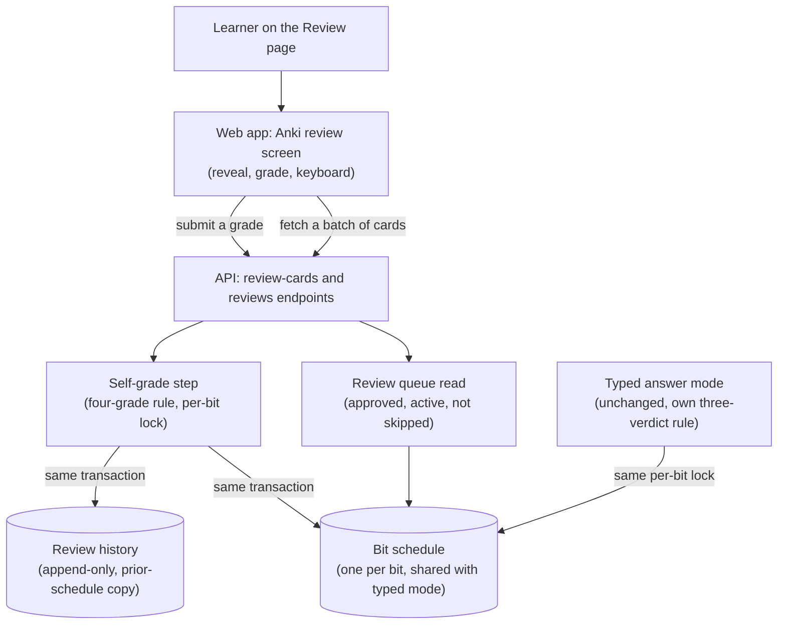

# Knowledge-bit Anki review

## What changes structurally

A second review mode is added inside the knowledge-bit entity. It lives next to the typed mode, and the two share nothing except the one schedule per bit. The self-grade path never calls an AI model. It reads a queue that includes the reference answer and never the bit's own text. A grade is applied by a new pure four-grade rule. The schedule update and an append-only history entry are written in one transaction, under the same per-bit lock the typed mode already uses. The web app gets its own Review page with its own components and its own client-side state (current card, revealed or not, keyboard handling). The typed page only gains a link to it.

## New infrastructure

None. No new process, worker, queue or cloud resource. Both endpoints run in the existing API service, behind its existing shared-secret or API-token check.

## Data model evolution

- A new append-only review-history table. Each row has the bit, the variant, the grade, a new-card flag, the time taken, a copy of the bit's prior schedule (empty for a never-reviewed card), the review time, and an undone-at marker.
- The bit-schedule table holds ease, interval, due date, last review and review count, shared by both modes.
- The prior-schedule copy holds every schedule column that exists when the grade is written. Columns added to the schedule later join the copy, and restoring an older copy defaults any missing key.
- No foreign keys, following the convention of the neighbouring knowledge-bit tables.

## Failure modes

- A grade that fails to save rolls back both writes. The client keeps the card on screen and lets the learner retry.
- A response lost after a successful save can lead to a retry that grades the bit twice. The client already blocks a second grade while one is in flight.
- The queue keeps today's fair-cycling order. It does not filter by due date, and it can serve two variants of one bit in the same batch. A small deck therefore cycles, and sibling variants can both be graded.
- A grade waits on the per-bit advisory lock while typed grading of the same bit is in flight. The pool's connection timeout covers only acquiring a connection, so the wait itself is not time-bounded and ends when the other grade finishes.
- A grade for a bit that is no longer approved is refused before any write.

## Rollout

- Standard deploy. CI applies the generated migration before the API deploys, and the web app deploys after the API.
- Dropping the history table needs its own generated migration, never a hand edit.

## Four-grade rule

A never-reviewed card comes back in 1 day after Again, Hard or Good, and in 4 days after Easy, with ease kept at 2.5. A reviewed card: Again resets to 1 day with ease −0.20; Hard multiplies the interval by 1.2 with ease −0.15; Good multiplies it by ease; Easy multiplies it by ease × 1.3 with ease +0.15. The interval uses the pre-grade ease. Ease stays within 1.3–3.0 and the interval within 1–180 days. The typed mode keeps its own three-verdict rule.
