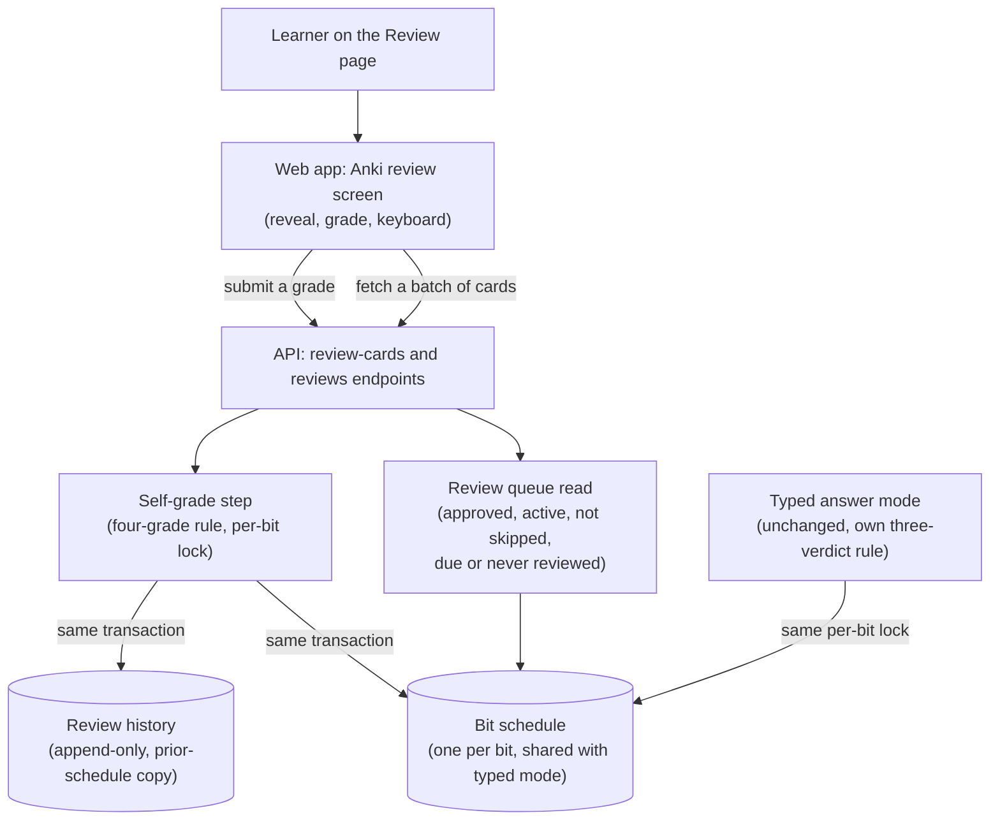

# Knowledge-bit Anki review

## What changes structurally

A second review mode is added inside the knowledge-bit entity. It lives next to the typed mode, and the two share nothing except the one schedule per bit. The self-grade path never calls an AI model. It reads a queue that includes the reference answer and never the bit's own text. A grade is applied by a new pure four-grade rule. The schedule update and an append-only history entry are written in one transaction, under the same per-bit lock the typed mode already uses. The web app gets its own Review page with its own components and its own client-side state (current card, revealed or not, keyboard handling). The typed page only gains a link to it.

## New infrastructure

None. No new process, worker, queue or cloud resource. Both endpoints run in the existing API service, behind its existing shared-secret or API-token check.

## Data model evolution

- A new append-only review-history table. Each row has the bit, the variant, the grade, a new-card flag, the time taken, a copy of the bit's prior schedule (empty for a never-reviewed card), the review time, and an undone-at marker.
- The bit-schedule table holds ease, interval, due date, last review and review count, shared by both modes.
- The prior-schedule copy holds every schedule column that exists when the grade is written. Columns added to the schedule later join the copy, and restoring an older copy defaults any missing key.
- No foreign keys, following the convention of the neighbouring knowledge-bit tables.

## Failure modes

- A grade that fails to save rolls back both writes. The client keeps the card on screen and lets the learner retry.
- A response lost after a successful save can lead to a retry that grades the bit twice. The client already blocks a second grade while one is in flight.
- Scoped queues (tag, topic, single bit) keep fair cycling by review count with no due filter, so they can serve two variants of one bit in a batch and sibling variants can both be graded. The unscoped queue does not (see Due queue).
- A grade waits on the per-bit advisory lock while typed grading of the same bit is in flight. The pool's connection timeout covers only acquiring a connection, so the wait itself is not time-bounded and ends when the other grade finishes.
- A grade for a bit that is no longer approved is refused before any write.

## Rollout

- Standard deploy. CI applies the generated migration before the API deploys, and the web app deploys after the API.
- Dropping the history table needs its own generated migration, never a hand edit.

## Four-grade rule

A never-reviewed card follows the learning steps below. A reviewed card: Again sends it to relearning with ease −0.20 (see Learning steps); Hard multiplies the interval by 1.2 with ease −0.15; Good multiplies it by ease; Easy multiplies it by ease × 1.3 with ease +0.15. The interval uses the pre-grade ease. Ease stays within 1.3–3.0 and the interval within 1–180 days. The typed mode keeps its own three-verdict rule.

## Due queue

The unscoped Anki queue serves only bits that are approved, whose topic is not skipped, and that have no schedule row or a due date at or before now. Each bit contributes one card: basic (front/back), then fill-in-the-blank, then why-question. Due bits come first (oldest due date first), then never-reviewed bits (oldest bit first). Scoped queues keep their own behaviour and ignore the due rule and the cap.

New cards are capped at 20 per local day. The count is the non-undone first-time reviews since local midnight, and the learner's day comes from the `tz` query parameter (IANA name, default UTC, invalid gives 400). The cap and `newRemainingToday` are global, not per scope.

The cards response also carries counts (`new`, `learning` for step cards due within the learn-ahead window, `review` for due day-based bits), `newRemainingToday`, and `nextDueAt`: the earliest future due date in scope, or the next local midnight when only capped new cards remain. Each card carries `intervalPreview`, the seconds until it returns after Again, Hard, Good or Easy, computed on the server by the same four-grade rule as a real grade. The web app labels the grade buttons with it, lowers the counts as cards are graded within a batch, and shows a done-for-today screen with the next due time when the queue is empty.

The typed answer queue gets the same unscoped rule (due or never reviewed, one variant per bit), picking the variant with the fewest attempts, then fill-in-the-blank, then why-question. It never serves basic cards in any scope, topic due counts ignore bits that have only a basic card, and typed grading refuses a basic card with 409 `kind_not_typed` before any grader call.

## Learning steps

The schedule row stores `phase` (`learning`, `review` or `relearning`; no row means new), `learning_step` (index into the active step list) and `lapses`. Existing rows read as review, step 0, 0 lapses. Ease never changes inside a step.

| From | Again | Hard | Good | Easy |
|---|---|---|---|---|
| new / learning step 0 | step 0, 1m | step 0, 5.5m | step 1, 10m | review, 4d |
| learning step 1 | step 0, 1m | step 1, 10m | review, 1d | review, 4d |
| review | relearning, 10m, lapses +1, ease −0.20 | review rule | review rule | review rule |
| relearning | stays, 10m | stays, 15m | review at the post-lapse interval (min 1d) | review at that interval + 1d |

A stored step past the list counts as the last step. An unknown stored phase reads as review.

The unscoped queue lists learning and relearning cards first, then due reviews, then new cards. When those leave free slots, cards in a step that are due within the next 20 minutes fill them, so a sitting does not end a minute before a card returns. Scoped queues keep their own order and show the stored phase.

A typed-mode verdict sets the phase to review and the step to 0 and leaves `lapses` alone. The review history snapshot of the prior schedule carries `phase`, `learningStep` and `lapses`; snapshots written earlier lack them and read as review, 0, 0. The grade result returns `lapses`.

## Session controls

**Undo.** `DELETE /knowledge-bits/reviews/:id` restores the schedule from the grade's prior-schedule snapshot and marks the review undone. A grade is undoable only while it is the latest: not undone, no later live review of the bit, and the schedule's `lastReviewedAt` still equals the review's `reviewedAt` (typed answers write no history row, so this timestamp is the signal). Otherwise the answer is 409 `not_latest` and nothing is written; an unknown review is 404 `review_not_found`. Undoing the first grade of a card leaves an ungraded row, so the card is new again and leaves the daily new-card count. A suspend or bury set after the grade is kept; a suspension caused by the undone grade itself (a leech) is lifted. Undo runs under the same per-bit lock as grading.

**Suspend and bury.** `PATCH /knowledge-bits/:id/schedule` takes `{suspended?, buried?, tz?}` (at least one of the first two). `suspended_at` and `buried_until` live on the schedule row. Bury lasts until the end of the learner's local day (`tz`, default UTC). Bits that are not approved give 403, missing bits 404. A card never graded gets an ungraded row (`review_count` 0) that every reader treats as new. Unsuspending is API-only (`{suspended:false}`); the review screen has no unsuspend control.

**Eligibility.** Both queues (Anki and typed, scoped and unscoped) and the topic and module due counts skip suspended bits and bits buried past now. A bit with no schedule row passes.

**Leeches.** A leech is derived, never stored: `lapses >= 8`. A grade that raises `lapses` to 8, 12, 16 and so on suspends the card in the same transaction as the grade. Typed verdicts never auto-suspend. Review cards carry `leech`, and the grade result carries `leech` and `suspended`.

**Editing.** `PATCH /knowledge-bits/question-variants/:id` works for any bit that is not rejected. An edit supersedes the variant with a new one, so the session swaps the returned variant id and text into every reference to that bit.

**Session state.** Progress, the undo list (grades, suspends and buries), edits and the end-of-session summary live in client state only and are lost on reload; everything saved is already on the server.
